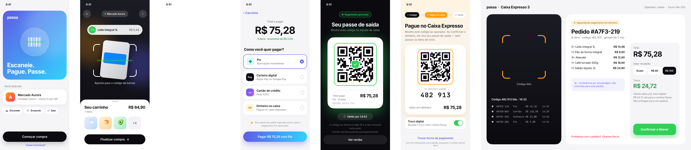

# Passa — self-checkout pelo celular para mercados

> **Escaneie. Pague. Passe.**

O Passa é um SaaS para mercados e comércios. O cliente abre a câmera do celular, escaneia o código de barras de cada produto e ensacola enquanto compra. O carrinho do app e o carrinho de verdade enchem juntos. No fim, ele paga no app e recebe um **QR code de saída**. No balcão, o caixa escaneia esse QR para validar o pagamento e liberar a saída.

Quem paga em **dinheiro** também usa o app. O pagamento acontece no caixa expresso, e o mesmo QR vira o passe de saída. Detalhes em [docs/FLUXO-DINHEIRO.md](docs/FLUXO-DINHEIRO.md).



## Estrutura do repositório

| Caminho | O que é |
|---|---|
| [`design/`](design/) | Design UX/UI no FigCraft (`passa-app.figcraft`) e exportações PNG |
| [`landing/`](landing/) | Landing page (React + Vite + GSAP + Three.js) com demo interativa |
| [`docs/DESIGN.md`](docs/DESIGN.md) | Sistema visual: cores, tipografia, materiais e movimento |
| [`docs/FLUXO-DINHEIRO.md`](docs/FLUXO-DINHEIRO.md) | Proposta de fluxo para pagamento em dinheiro e antifraude |
| [`docs/TESTES.md`](docs/TESTES.md) | Estratégia de testes, como rodar e o que cada suíte cobre |

## Começando

Pré-requisito: Node.js 20+ (o projeto foi desenvolvido com Node 24).

```bash
cd landing
npm install
npm run dev        # http://localhost:5173
npm test           # 131 testes (Vitest + Testing Library)
npm run coverage   # relatório de cobertura em landing/coverage/
npm run build      # build de produção em landing/dist/
```

## Fluxo do cliente

1. **Check-in**: lê o QR da entrada da loja (ou é localizado por GPS).
2. **Escaneie**: a câmera lê o EAN e o item entra no carrinho do app.
3. **Pague**: Pix, carteira digital, cartão ou **dinheiro no caixa**.
4. **Passe**: um QR verde dinâmico (renova a cada 30 s, uso único) é mostrado no balcão de saída.

## Telas do design (FigCraft)

| # | Tela | Observação |
|---|---|---|
| 01 | Check-in | Loja identificada e CTA "Começar compra" |
| 02 | Scanner | Câmera com viewfinder, toast "+1" e carrinho em sheet |
| 03 | Carrinho | Itens com stepper, desconto do clube e total |
| 04 | Pagamento | Pix, carteira digital, cartão, dinheiro no caixa |
| 05 | Passe de saída | QR verde com timer de rotação |
| 06 | Dinheiro no caixa | QR âmbar, código de 6 dígitos e opção de troco digital |
| 07 | Caixa (tablet) | Console do operador: pedido, valor recebido, troco, liberar |
